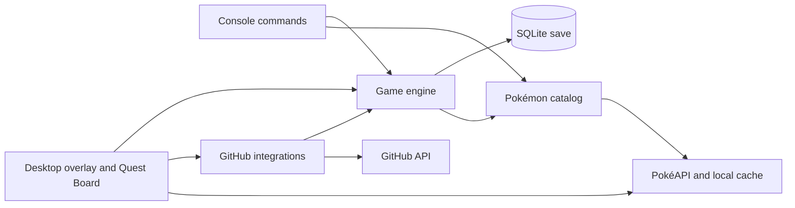

# Pokemac

[](https://github.com/Lnvqntx/Pokemac/actions/workflows/tests.yml)

Pokemac is a Pokémon-themed task game and desktop companion for macOS.
Finish real tasks to train your lead Pokémon, earn Poké Balls, and catch
wild Pokémon. Use the terminal, the desktop Quest Board, or GitHub issues
to track your progress.

## Features

- Roaming desktop companions, a party of six, and unlockable showcase forms.
- Manual quests, type-linked training, and three daily side quests with one reroll.
- A Quest Board with open tasks, recent rewards, and your collection.
- GitHub issue rewards and daily streak credit for commits.
- A terminal Pokédex, offline metadata catalog, and local SQLite saves with daily backups.

## Setup

Use Python 3.10 or newer. From a local checkout, create a virtual environment
and install the package.

```sh
python3 -m venv .venv
source .venv/bin/activate
python -m pip install .
pokemac --help
pokemac game status
pokemac-overlay
```

The desktop overlay and login agent are designed for macOS. The CLI and
offscreen test suite also run on Linux. The original
`python -m pokemac.cli.game` and other module entry points still work,
including `python -m pokemac.overlay`.

See [GitHub integration](#github-integration) for token permissions, Keychain
storage, and issue labels.

## Architecture



The engine owns tasks, lead selection, rewards, and encounters. The catalog
supplies Pokémon types, evolution data, and artwork URLs. Integrations
normalize GitHub activity and send completions through the same reward
rules. The overlay refreshes from the same save as the CLI.

## Pokédex

```sh
pokemac pokedex pikachu
python -m pokemac.cli.greet
```

The Pokédex displays a front sprite next to the stats in terminals that support
Unicode and 24-bit color. `greet` picks a random Pokémon from the original 151
and prints its name and sprite.

PokéAPI responses are saved as JSON in `.cache/` in the current working
directory, and downloaded sprites are saved in `.cache/sprites/`. Once both
are cached for a Pokémon, repeat lookups work offline. The CLI displays height
in meters and weight in kilograms, while `get_pokemon()` returns PokéAPI's
original decimeters and hectograms.

## Pokémon catalog

```sh
pokemac data stats
pokemac data forms charizard
pokemac pokedex charizard --form mega-y
pokemac pokedex lugia --form dynamax
```

The bundled `pokemac/catalog/catalog.json` contains metadata from all nine
generations returned by PokéAPI. The November 20, 2026 sync returned **1,025
species, 1,351 varieties, and 540 evolution chains**, including 97 Mega and 34
Gigantamax varieties. The 1,457,956-byte file references artwork by URL.
Dynamax is a visual effect that uses the default variety's stats. It adds no
entry to the variety count.

```sh
pokemac data sync
pokemac data sync --gen 2
```

Sync uses at most five concurrent requests, backs off on transient failures
and rate limits, and reuses existing JSON files in `.cache/`. Run it again
from the same directory to resume an interrupted sync. `--gen` updates the
selected generation while retaining other catalog entries. A sync warns if
the output exceeds 3 MB. Updates go to `~/.pokemac/catalog.json`, leaving the
catalog bundled with the package available as a fallback.

## Task game

```sh
pokemac task add "Clear my inbox" --kind quest --difficulty medium
pokemac task add "Ship the keyboard shortcut" --type electric --difficulty hard
pokemac task add "Water the plants" --kind side_quest --difficulty easy
pokemac task list
pokemac task list --all
pokemac task done 1
pokemac task delete 3
pokemac game inventory
pokemac game status
pokemac game catch great
```

A new save starts with a level-1 Bulbasaur, three Poké Balls, one Great Ball,
and one Ultra Ball. A task defaults to an easy quest. Filter `task list` with
`--status pending` or `--status completed`.
Deleting a task removes it from the task list and Quest Board while keeping
any rewards already earned. Use the Quest Board's reroll for daily offers.

- **Quest** rewards balls and earns a guaranteed wild encounter until the
  daily quest cap is reached. The default cap is three per local calendar day.
  Set `POKEMAC_DAILY_QUEST_ENCOUNTER_CAP` to a different nonnegative number.
- **Side quest** has a 25% chance to earn an encounter independently of the
  quest cap.
- **Training** requires a Pokémon type. A training task appears and can be
  completed when the lead has that type. Dual-type Pokémon match either type.
  Use `task add --type <pokemon-type>` to create training, `--xp` to set a
  custom training reward, and `task list --all` to see training for other
  types. Existing fixed-recipient training uses the saved Pokémon's
  primary type and keeps its saved XP reward.

All quests, side quests, and training require a lead and award XP to that
Pokémon. The difficulty sets the default amount. The companions keep roaming while only
the lead gains XP, levels up, evolves, or unlocks showcase forms from tasks.

| Training type | Example |
| --- | --- |
| Electric | Building and shipping |
| Psychic | Learning |
| Fighting | Exercise |
| Fairy | Creative work |
| Steel | Discipline and finance |
| Water | Recovery |
| Fire | Deep focus |
| Grass | Habits |
| Bug | Debugging |
| Flying | Networking |

| Difficulty | XP | Quest ball reward | Encounter tier odds |
| --- | --- | --- | --- |
| Easy | 20 | 3 Poké Balls | 80% common, 20% uncommon |
| Medium | 40 | 3 Poké Balls, 1 Great Ball | 65% uncommon, 35% rare |
| Hard | 80 | 2 Great Balls, 1 Ultra Ball | 92% rare, 8% legendary |
| Epic | 200 | 2 Ultra Balls, 1 Master Ball when eligible | 60% rare, 30% legendary, 10% mythical |

Epic quests can grant one Master Ball every 14 elapsed days. Each completed
seven-day window since first launch grants 10 Poké Balls plus one per quest
completed in that window, up to 20. Unclaimed windows are paid when you
return. Each window is paid once per save. Saves from before weekly rewards
start these windows when they are upgraded. Tasks from before task types
become easy quests and keep their completion history and recorded XP.

XP is cumulative and starts at zero. The default curve rounds
`5000 × ((level − 1) / 99)^1.8` and keeps each level's threshold distinct.
Levels 16, 36, and 100 require 167, 769, and 5,000 XP. Existing saves keep each
Pokémon's level and start at its new XP threshold. To configure the curve for
both the CLI and overlay, create `~/.pokemac/progression.toml`.

```toml
[xp]
total = 5000
exponent = 1.8
```

Changing these settings places each Pokémon at the start of its current level
on the updated curve. On level-up, the game checks the catalog's evolution
chains. Evolutions that require only a minimum level happen automatically. The catalog retains
item, trade, friendship, and other triggers for reference. If a chain is
missing locally and PokéAPI is unavailable, rewards are saved and the check
is retried after the next XP award. Completing at least one task on each
consecutive local calendar day builds your daily streak.

The game draws a random species from the selected tier in the full catalog,
including Lugia. Mythical and
legendary flags take priority. Other species are common with a capture rate
of 150 or higher, uncommon from 75 to 149, and rare below 75. Earned encounters
queue in order while another is visible. The next encounter's 60-second timer
starts when it becomes active.

`catch` uses a Poké Ball by default. Use `catch great`, `catch ultra`, or
`catch master` for another ball. The catch chance is
`min(1, sqrt(capture_rate / 255) × multiplier)`. Each encounter allows up to
three throws before the Pokémon flees.

| Ball | Catch multiplier |
| --- | --- |
| Poké Ball | 1× |
| Great Ball | 1.5× |
| Ultra Ball | 2× |
| Master Ball | Always catches |

The SQLite save lives at `~/.pokemac/pokemac.db`. Set `POKEMAC_DB_PATH` to use
another file. On the first save access each local calendar day, Pokemac takes
a SQLite snapshot in `~/.pokemac/backups/` and keeps the seven most recent.
With a custom save path, snapshots go into a `backups/` directory beside the
save. If a writer is active, Pokemac tries again on the next access. Species
and evolution data are cached in `.cache/species/` and `.cache/evolution-chains/`
in the current working directory.

### Daily side quests

The Today tab rolls over at **5 am local time**. Midnight and the hours before
5 am still show the previous day's offers, completions, and reroll status.
Pokemac deals three offers for the current rotation when it first opens or
refreshes that rotation. At least two match the lead when
its types have enough available quests in the pool. A lead with no supported
type gets three general picks. The draw skips offers from the previous seven
days, including ones you rerolled. Today's picks stay in the save across
restarts and expire at the next 5 am rollover.

Use **Reroll** in **Today** to replace unfinished offers once per day.
Completed offers stay on the board. Each daily completion gives the
current lead **20 XP**, **one Poké Ball**, and a **25% chance** of a wild
encounter. The listed difficulty sets the encounter tier odds. Any lead
can complete a daily offer.

### GitHub integration

With the GitHub CLI installed, run `gh auth login --hostname github.com` for
the account whose issues and commits you want to track. Pokemac reads that
credential through `gh auth token`. On macOS without `gh`, the Pokemac login
command prompts for a token and saves it to your login Keychain via `keyring`.
The SQLite save and TOML file hold repository and sync settings. The token
stays in the credential provider.

For a fine-grained GitHub token, select the repositories you want to track
and grant **Issues: Read-only** and **Contents: Read-only**. GitHub adds
**Metadata: Read-only** automatically. An authenticated classic token can read
public repository data without a repository scope. Private repositories
require the broader `repo` scope with a classic token. Pokemac only makes read
requests to GitHub.

```sh
pokemac integrations github login
pokemac integrations github add-repo owner/name --import-history
pokemac integrations github sync-now
pokemac integrations github status
pokemac integrations github remove-repo owner/name
```

The overlay checks for updates every five minutes. With the overlay closed,
run `sync-now` to fetch updates. Polling uses ETags, retains the last open issue
list offline, and backs off after errors. `sync-now` also honors a scheduled
retry. Open issues you authored or are assigned to appear in `game task list`
and the companion popup. **Open issue** opens GitHub in your browser. The
menu bar shows the latest sync status.

GitHub issues earn the normal task rewards when they are closed as completed
after the repository was added and you authored the issue or are assigned to
it. The stable GitHub issue ID prevents repeat rewards after a reopen. Use
`add-repo --import-history` to mark issues that are already closed as
seen, including if they reopen and close again later. `sync-now --import-history`
and `login --import-history` schedule the same import for the repositories
already configured. Commits GitHub attributes to you on any branch of a
configured repository count toward the task streak, up to one credit
per local calendar day across all commits and task completions.

Unlabeled issues are medium quests. Use `easy`, `medium`, `hard`, or `epic`
to choose the difficulty. The highest difficulty label wins when several
are present. A `type:<name>` label, such as `type:electric`, or
`training_type` in the mapping creates type-linked training. If the lead
doesn't match when Pokemac syncs the closure, the reward waits for a later
sync with a matching lead. Quests and side quests award XP to the lead at
the time Pokemac applies the completion. Old `pokemon:<name>` labels use the
named Pokémon's primary type. The `type:<name>` label takes precedence when
both labels are present.
Use `~/.pokemac/github.toml` to override these
defaults per label. Labels are case-insensitive. When mappings set the same
field, the alphabetically first matching label supplies that field.

```toml
[labels]
maintenance = { kind = "side_quest", difficulty = "hard" }
starter-training = { training_type = "grass", difficulty = "easy" }
shipping = { training_type = "electric", difficulty = "hard" }
```

### Party and collection

Your party can hold up to six Pokémon from your collection. Find their IDs
under **Collection** in the Pokemac menu bar or in the `catch` command's
output. Manage the party from the **Party** menu or the CLI.

```sh
pokemac game party add 2
pokemac game party list
pokemac game party remove 2
```

Choose **Set as lead** in a companion's popup or under **Party** in the menu
bar. The switch takes effect immediately and each Pokémon keeps its XP.
Removing the lead promotes the next member. Removed members stay in the collection.

Existing saves upgrade automatically and keep their party, slots, and lead.
The collection shows **Unknown** for catch dates that older saves never recorded.

## Desktop overlay

```sh
pokemac-overlay
```

Party members roam independently across the usable area of their display.
Flying and Ghost types drift and bob. Other Pokémon wander, change direction,
pause, and occasionally nap. Drag a Pokémon anywhere on a display, or onto
another display, and it resumes roaming from where you release it. Each
Pokémon has its own small window and its transparent pixels pass clicks
through to the app underneath.

Click the lead to see its level and XP, your streak and ball count, and a
scrollable list grouped into Quests, Side quests, and Training. Each group
shows its count. Long titles show two lines and the full title on hover.
Click **Done** to complete a local task or **Open issue** to open a GitHub task.
Click a companion for its level, XP, and **Set as lead**. The opaque popup
stays where you opened it while the sprites roam, with a maximum height of
420 pixels. Level-ups show a short message,
and evolutions flash the evolving member's artwork.

Open **Quest board** from the menu bar or the lead's popup.

- **Today** shows daily offers, completions, and the reroll button.
- **Quests** shows manual tasks and GitHub issues with their difficulty.
  Use **Done** for a manual task or **Open issue** to close it in GitHub.
  The **Add quest** form accepts a title, task type, and difficulty.
  For training, it also asks for the Pokémon type.
- **Completed** shows the last 30 completions and their recorded rewards.
  Completions from older saves remain visible with unavailable reward details.
- **Collection** shows your caught Pokémon and their party roles.

Board and GitHub completions show an XP and ball summary near the lead.
Another toast announces a wild Pokémon when it becomes active. On macOS,
Pokemac also uses `osascript` for desktop notifications when another app
is in front. Notification delivery follows your macOS notification settings.

At level 100, use the lead's popup or **Showcase forms** in the menu bar to
switch between Normal and the Pokémon's available Mega and Gigantamax forms.
Mega X and Mega Y have separate entries. Pokémon without either kind can
Dynamax, which displays their normal artwork at 1.5× size with a pulsing red
glow. Mega and Gigantamax artwork comes from the catalog and falls back to
normal artwork when unavailable. The save remembers each Pokémon's form.

The Pokemac menu bar icon lets you show or hide the party, manage membership
and the lead, view every caught Pokémon with its species, level, and caught
date, or quit. The game continues to refresh while the overlay is hidden.

A wild Pokémon earned by completing a task appears in its own window near
the screen edge, even with a full party. Click its sprite to open the ball
picker, see your counts and the catch chances, and choose a ball. The overlay
refreshes from the same save as the CLI every three seconds. It uses official PokéAPI artwork
when available and falls back to the front sprite. Artwork is cached under
`.cache/artwork/` and is scaled for the display's pixel density.

To test progression or encounters immediately, run these commands while the
overlay is open. Giving XP uses the usual level-up and evolution rules and
leaves tasks, inventory, and streaks alone. The wild encounter appears on the
next refresh.

```sh
pokemac game dev give-xp 167
pokemac game dev set-level 1 100
pokemac game dev spawn-wild
pokemac game dev give-balls master 1
```

`dev spawn-wild` immediately replaces the visible encounter for testing.
`dev give-balls` is independent of quest reward limits.
`dev set-level` puts a Pokémon at the start of the given level and keeps its
current species, so you can test its showcase forms directly.

On macOS, install the login agent from your Pokemac virtual environment. It
starts the overlay in the current GUI session and at subsequent logins. The
agent restarts after a crash or nonzero exit. **Quit** exits cleanly and leaves
it stopped for the rest of the session. Logs go to `~/.pokemac/overlay.log`.
The agent preserves `POKEMAC_DB_PATH` and `POKEMAC_DAILY_QUEST_ENCOUNTER_CAP`
if they are set at install time. Reinstall
if you move the checkout or virtual environment. Uninstalling unloads the
agent and removes the plist.

```sh
pokemac install-login
pokemac install-login --status
pokemac install-login --uninstall
```

[Screenshot placeholders](docs/screenshots/README.md)

## Troubleshooting

Run `pokemac doctor` to see the save path and schema version, GitHub credential
presence, launch agent status, the last ten overlay log lines, and the active
catalog file. The log tail redacts GitHub credentials.

- **Overlay missing after login**. Run `pokemac install-login --status` and
  check `~/.pokemac/overlay.log`. Reinstall the login agent from the activated
  virtual environment if its Python executable moved.
- **GitHub issue has no reward**. Check `pokemac integrations github status`.
  Confirm the token has access to the repository, the issue was closed as
  completed after the connection date, and the lead matches any training label.
- **Catalog unavailable**. Use `pokemac doctor` to identify the active file.
  Run `pokemac data sync` to refresh the metadata.
- **Save needs recovery**. Quit the overlay, copy a snapshot to a new file,
  and point `POKEMAC_DB_PATH` at the copy to inspect it before replacing a save.

## Manual macOS checklist

- [ ] Install the agent and confirm `--status` reports a running PID. Check the
  log path, then sign out and back in to verify it starts at login.
- [ ] Kill the reported overlay PID with `kill -KILL <pid>` and confirm
  `--status` shows a new PID. Select **Quit** and verify the last exit code
  is 0 and the process stays stopped. Uninstall and confirm the agent is gone.
- [ ] Add six party members, including a Flying or Ghost type. Watch them
  move in both axes, then verify the floating Pokémon bob and others pause.
- [ ] Drag a sprite to a different monitor, including one arranged to the left
  or above the primary display. Release it and verify it resumes from the drop.
  Change the Dock position or unplug a display and check the sprites remain
  inside the usable area.
- [ ] Click through a sprite's transparent corners onto an app underneath.
  Click the visible sprite to open its panel and test its Retina artwork,
  window focus, and menu bar controls.
- [ ] Complete a quest with six party members. Click the wild sprite and check
  that the ball picker shows counts and odds. Verify that a miss leaves two
  throws, a catch closes the picker, and an unused encounter expires after a minute.
- [ ] Connect a GitHub repo with an open issue you authored or were assigned.
  Verify the popup link opens the issue and the menu reports a successful sync.
  Disconnect the network and verify the last synced open issues stay visible.
- [ ] Add training for two Pokémon types and switch the lead from its
  companion popup and the tray. Verify that each popup shows only eligible
  training when opened for the lead, and completing a quest awards XP only
  to the lead.
- [ ] Open a lead popup with many tasks and long titles. Verify the list
  scrolls, full titles show on hover, and the popup stays in place as sprites roam.
- [ ] Open the quest board from both entry points. Reroll today's unfinished
  offers, restart the overlay, and verify the picks and reroll limit persist.
- [ ] Complete a board quest and check its rewards in **Completed**. Bring
  another app to the front and verify a synced GitHub completion sends a
  desktop notification as well as a toast.
- [ ] Use `dev set-level` to unlock showcase forms. Switch forms from the popup
  and menu bar, check the Dynamax size and red pulse, and restart the overlay to
  confirm it remembers the selected form.

## Development and license

Run the tests without a display.

```sh
python -m pip install ".[test]"
QT_QPA_PLATFORM=offscreen python -m pytest
```

Pokemac is a non-commercial fan project. Pokémon and related names and
artwork belong to Nintendo, Game Freak, and The Pokémon Company. Artwork is
fetched from PokéAPI at runtime and never redistributed. The Pokemac code
is available under the [MIT License](LICENSE).
